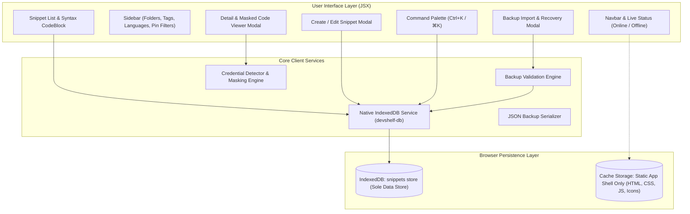

# DevShelf — Developer Snippet Manager

DevShelf is an offline-first, keyboard-centric code snippet manager built with a premium dark charcoal aesthetic, pure React (JavaScript/JSX), Tailwind CSS, Lucide icons, and persistent local storage powered by native Promise-based IndexedDB.

---

## Key Features

- **Offline-First PWA**: Fully functional offline via custom Service Worker caching. The application shell and static assets are precached, with an automated SPA navigation fallback.
- **Strict Data Privacy**:
  - **IndexedDB (`devshelf-db`) is the sole persistent store for all snippet records.**
  - **Zero snippet code, titles, tags, folder names, or credentials ever enter Cache Storage or `localStorage`.**
  - No remote APIs, telemetry, analytics, or external tracking dependencies.
- **Sensitive-Data Detection & Visual Masking**:
  - Heuristic detection engine detecting 7 credential patterns (AWS keys, OpenAI/GitHub/GitLab tokens, JWTs, Bearer tokens, password/secret assignments, embedded database connection strings, PEM private keys).
  - Non-destructive visual masking: snippets display `••••••••` in previews while keeping raw code untouched in IndexedDB.
  - Contextual reveal/hide controls and copy protection (warns when copying unmasked credentials).
- **Global Command Palette (`Ctrl+K` / `⌘K`)**:
  - Search across snippets, languages, folders, and tags.
  - Execute quick commands (`> New Snippet`, `> Switch Theme`, `> Export All JSON`, `> Import JSON Backup`).
  - Full keyboard accessibility with focus trapping, Arrow navigation, Enter execution, and Escape dismissal.
- **Syntax Highlighting & Organization**:
  - Syntax-aware rendering for JavaScript, Python, SQL, CSS, Bash, and JSON with line numbers.
  - Multi-field instant search, language filters, folder hierarchy, tag system, and pinned-first sorting.
- **Robust Backup & Recovery Engine**:
  - Versioned JSON export/import (`devshelf-backup-YYYY-MM-DD.json`).
  - Pre-import validation: structure verification, size constraints, duplicate ID detection, and independent security re-computation.
  - Conflict resolution modes: **Merge** (`skip`, `overwrite`, `keep_both`) and **Atomic Replace** (with transactional rollback and confirmation safeguards).

---

## Architecture



---

## Sensitive-Data Detection & Limitations

DevShelf includes regular-expression heuristic detection in `src/utils/masker.js` to identify credentials and prevent accidental screen sharing or shoulder surfing.

> [!WARNING]
> **Heuristic Limitations**:
> Regular-expression based detection cannot guarantee detection of every secret or custom credential format. Never commit sensitive production credentials to public repositories or rely on heuristic client-side masking as an encryption substitute. Local IndexedDB is unencrypted browser storage.

---

## Offline PWA & Browser Restrictions

- **Service Worker Lifecycle**:
  - Pre-caches the application shell and static assets at build time (`dist/sw.js`).
  - Updates cache automatically across releases using versioned names (`devshelf-shell-v*`), cleaning up stale caches during activation.
  - Serves `index.html` as navigation fallback when offline.
- **Data Privacy**:
  - The Service Worker caches strictly GET requests for same-origin static assets and Google Fonts.
  - No snippet data, backups, or credentials are ever requested over network or written to Cache Storage.
- **Browser Restrictions**:
  - **Clipboard API**: Copying code snippet text requires a secure context (`https://` or `http://localhost`) in modern browsers.
  - **First Load**: The application must be visited once online (or via local server) to allow the Service Worker to precache the application shell before offline launch is possible.

---

## Development & Build Commands

```bash
# Install dependencies
npm install

# Start Vite development server (Service Worker disabled in development)
npm run dev

# Run all unit and contract tests (IndexedDB, Filter, Masker, Backup, PWA)
npm test

# Run linter (oxlint)
npm run lint

# Build for production (compiles bundle and generates dist/sw.js)
npm run build

# Preview production build locally on port 4173
npm run preview
```

---

## Automated Test Suites

DevShelf includes comprehensive automated test coverage:
- `tests/db.test.js`: IndexedDB schema, UUIDs, CRUD operations, transactions, and error handling.
- `tests/filter.test.js`: Tag sanitization, multi-field instant search, combined filters, and syntax tokenization.
- `tests/masker.test.js`: Credential detection across 7 categories, false-positive filtering, and overlap handling.
- `tests/backup.test.js`: JSON envelope validation, duplicate ID detection, fresh credential re-computation, merge conflict policies (`skip`, `overwrite`, `keep_both`), atomic replace, and transactional rollback.
- `tests/pwa.test.js`: Web App Manifest structure, icon file integrity/PNG signatures, Service Worker generation, and production-only registration guards.
- `tests/browser-phase7-offline.js`: Real browser E2E test in Microsoft Edge via Chrome DevTools Protocol (CDP) testing offline launch, IndexedDB persistence, offline CRUD, Command Palette, credential masking, and responsive layout audits.
